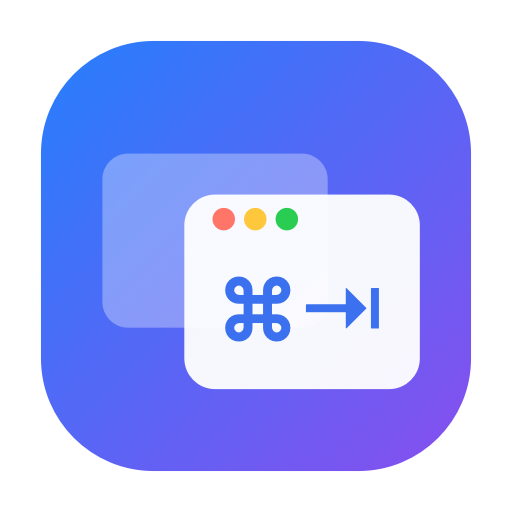
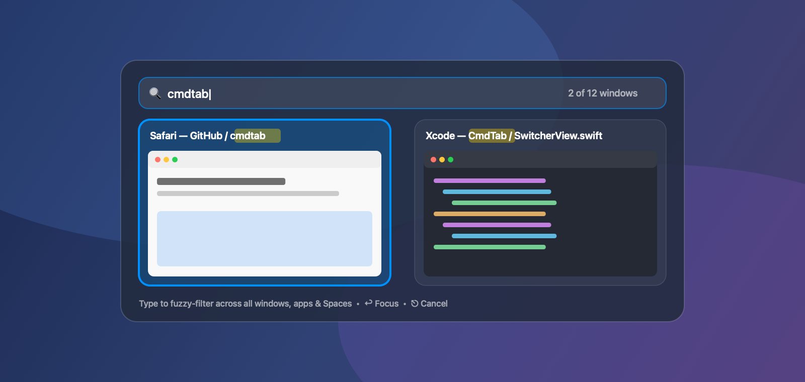

<p align="center">
  
</p>

<h1 align="center">CmdTab</h1>

<p align="center">
  A fast, native macOS window switcher built from scratch in Swift, SwiftUI, AppKit &amp; ScreenCaptureKit — switch between <strong>every window</strong> (not just apps) with live previews, instant fuzzy search, quick-jump numbers, window pinning, snapping, per-app exceptions, and <strong>25 languages</strong>.
</p>

<p align="center">
  <a href="../../releases/latest"></a>
  
  
  
  
  
</p>


macOS's built-in `⌘ + Tab` only switches between applications, leaving minimized windows, hidden apps, and multiple windows of the same app hard to reach. **CmdTab** replaces it with a blazing-fast, zero-dependency native Swift switcher packed with power features — completely free and open source.

## Highlights

- **Every Window, Not Just Every App.** Displays normal, minimized, hidden, fullscreen, and other-Space windows with clear status badges (`Space 2`, `Minimized`, `Hidden`, `Fullscreen`), and automatically unminimizes windows when switching to them.
- **3 Visual Styles &amp; Auto-Sizing Grid.** Choose between **Thumbnails** (live previews via `ScreenCaptureKit`), **App Icons** (Dock-like bar), and **Titles** (compact list). Size modes include `Small`, `Medium`, `Large`, and **`Auto`** — large previews when 2–4 windows are open, compact grid when 10+ windows are open.
- **Native Light, Dark &amp; System Themes.** Translucent macOS glass (`NSVisualEffectView`) with optional full-size window preview behind the switcher.
- **Live Fuzzy Search.** Press `Space` or `/` (or trigger `⌥ + Tab`) to fuzzy-filter across window titles and app names with highlighted character matches and live match counts.
- **Multiple Independent Shortcuts.** Configure as many shortcuts as you like — default presets include `⌘ + Tab` (All Windows), `⌥ + \`` (Active App Only), and `⌥ + Tab` (Instant Window Search) — each with its own Space/Screen/App filters, sort order, grouping, style override, and release behavior (`Focus`, `Hold`, `Search`).
- **Power Extras Built In.**
  - **Quick-Jump (`1–9`)**: Press any number `1–9` to jump straight to that window.
  - **Window Pinning (`P`)**: Pin favorite windows so they always stay first.
  - **Window Snapping (`[` / `]` / `\`)**: Snap the highlighted window to Left Half, Right Half, or Maximize right from the switcher.
  - **Hover &amp; Keyboard Window Actions**: Close (`W`), Minimize (`M`), Toggle Fullscreen (`F`), Hide App (`H`), Quit App (`Q`).
  - **Per-App Exceptions**: Hide specific apps or ignore shortcuts inside VMs and Remote Desktop apps (Finder, Screen Sharing, RDP, Parallels, VirtualBox, TeamViewer, Citrix pre-configured).
  - **Settings Backup**: Export and import your complete configuration as JSON.

| Live Fuzzy Search | Native macOS Settings |
|---|---|
|  |  |

## Keyboard Shortcuts (While Switcher Is Open)

| Key | Action |
|---|---|
| `⌘ + ⇥` / `⌘ + ⇧ + ⇥` | Open switcher &amp; cycle forward / backward |
| `⌥ + \`` | Switch windows of the active app only |
| `⌥ + ⇥` | Open directly in Live Search mode |
| `1` – `9` | Quick-jump directly to window 1–9 |
| `Space` / `/` | Toggle Live Fuzzy Search |
| `↑` `↓` `←` `→` | Navigate grid or list |
| `↩` | Focus (and unminimize) selected window |
| `⎋` | Cancel without switching |
| `W` | Close selected window |
| `M` | Minimize / restore window |
| `F` | Toggle fullscreen |
| `H` | Hide / unhide app |
| `Q` | Quit app of selected window |
| `P` | Pin / unpin window to the front |
| `[` / `]` / `\` | Snap window Left Half / Right Half / Maximize |

## Languages (25)

CmdTab includes full native `.lproj` localizations and live in-app language switching (no restart required):

> English · Deutsch · Español · Français · Italiano · Português · Nederlands · Polski · Čeština · Magyar · Română · Svenska · Türkçe · Ελληνικά · Русский · Українська · Български · Hrvatski · Српски · Slovenščina · Shqip · 日本語 · 한국어 · 简体中文 · 繁體中文

## Installation

### Download Release

1. Download the latest `CmdTab-v1.0.1-macOS-arm64.zip` from [Releases](../../releases/latest).
2. Unzip and move `CmdTab.app` into `/Applications`.
3. Launch `CmdTab.app` and grant **Accessibility** (for global shortcuts &amp; window management) and **Screen Recording** (for live thumbnails) in **System Settings → Privacy &amp; Security**.

### Build from Source

Requires macOS 14+ and Swift Command Line Tools (`swift --version`):

```bash
git clone https://github.com/leonsuv/cmdtab.git
cd cmdtab
./scripts/build_app.sh release
open build/CmdTab.app
```

> **Tip:** To keep macOS Accessibility &amp; Screen Recording permissions across local rebuilds, `build_app.sh` automatically signs with a local `"CmdTab Local Signing"` keychain certificate if present.

## License

MIT — see [LICENSE](LICENSE).
