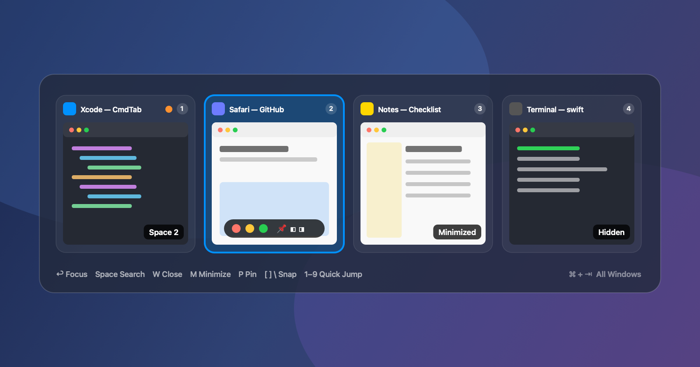
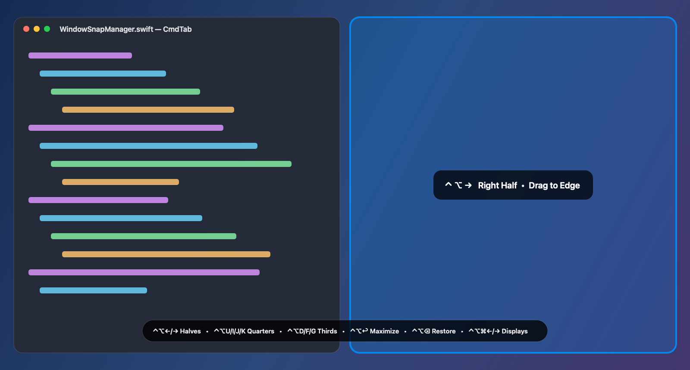
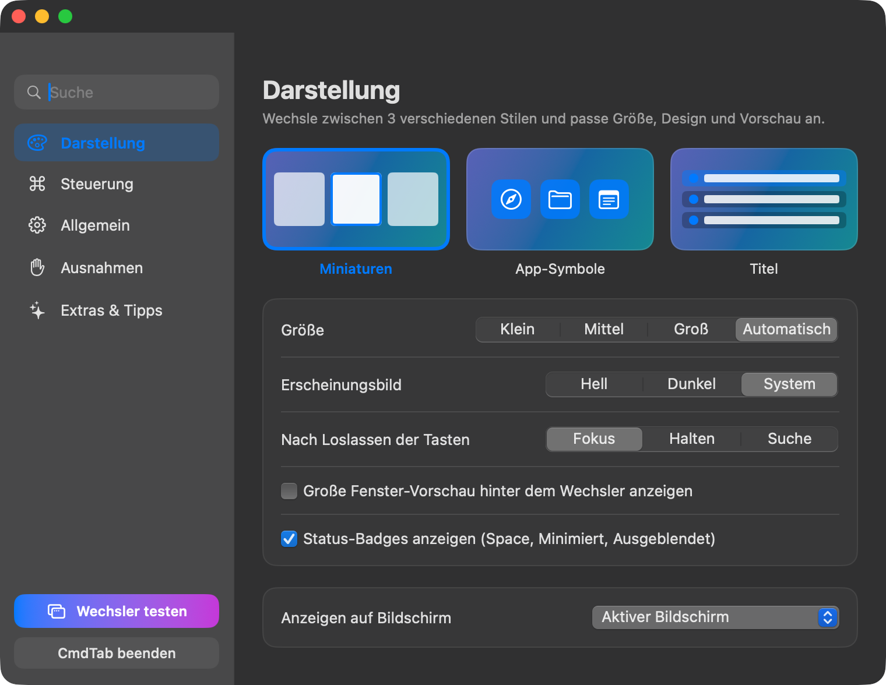

<p align="center">
  
</p>

<h1 align="center">CmdTab</h1>

<p align="center">
  A fast, native macOS <strong>Window Switcher &amp; Window Manager</strong> built from scratch in Swift, SwiftUI, AppKit &amp; ScreenCaptureKit — replacing both AltTab and Rectangle in one zero-dependency app with live previews, instant fuzzy search, drag-to-edge snapping, 23 global tiling shortcuts, per-app exceptions, and <strong>25 languages</strong>.
</p>

<p align="center">
  <a href="../../releases/latest"></a>
  
  
  
  
  
</p>



macOS's built-in `⌘ + Tab` only switches between applications, and native window tiling lacks customizable shortcuts, thirds, quarters, gaps, and multi-display controls. **CmdTab** combines a blazing-fast window switcher with a full Rectangle-class window manager — completely free and open source.

## Highlights

- **Every Window, Not Just Every App.** Displays normal, minimized, hidden, fullscreen, and other-Space windows with clear status badges (`Space 2`, `Minimized`, `Hidden`, `Fullscreen`), and automatically unminimizes windows when switching to them.
- **3 Visual Styles &amp; Auto-Sizing Grid.** Choose between **Thumbnails** (live previews via `ScreenCaptureKit`), **App Icons** (Dock-like bar), and **Titles** (compact list). Size modes include `Small`, `Medium`, `Large`, and **`Auto`** — large previews when 2–4 windows are open, compact grid when 10+ windows are open.
- **Full Rectangle-Class Window Snapping (v2.0).**
  - **23 Global Snapping Shortcuts** — Halves, Quarters, Thirds, Two-Thirds, Maximize, Almost Maximize, Maximize Height, Smaller/Larger, Center, **Restore original size**, and Next/Previous Display.
  - **Drag-to-Screen-Edge Snap Areas** — Drag any window to any of 8 configurable edges/corners with a smooth translucent glass **Snap Footprint** preview, optional **haptic feedback**, and **automatic unsnap/restore** when dragging a snapped window away.
  - **Fine-Grained Controls** — Configurable window gaps (`0–32 px`), repeated command cycling (`1/2 → 2/3 → 1/3` or move across displays), cursor warping across monitors, double-click titlebar to maximize/restore, and Stage Manager left margin.
- **Live Fuzzy Search.** Press `Space` or `/` (or trigger `⌥ + Tab`) to fuzzy-filter across window titles and app names with highlighted character matches and live match counts.
- **Multiple Independent Switcher Shortcuts.** Default presets include `⌘ + Tab` (All Windows), `⌥ + \`` (Active App Only), and `⌥ + Tab` (Instant Window Search) — each with its own Space/Screen/App filters, sort order, grouping, style override, and release behavior (`Focus`, `Hold`, `Search`).
- **Power Extras Built In.** Quick-Jump (`1–9`), Window Pinning (`P`), Hover &amp; Keyboard Actions (`W`, `M`, `F`, `H`, `Q`), Per-App Exceptions (Finder, Screen Sharing, RDP, Parallels, VirtualBox, TeamViewer, Citrix), and JSON Settings Export/Import.

| Window Snapping &amp; Drag-to-Edge Footprint | Live Fuzzy Search |
|---|---|
|  |  |

<p align="center">
  
</p>

## Keyboard Shortcuts

### Window Switcher

| Key | Action |
|---|---|
| `⌘ + ⇥` / `⌘ + ⇧ + ⇥` | Open switcher &amp; cycle forward / backward |
| `⌥ + \`` | Switch windows of the active app only |
| `⌥ + ⇥` | Open directly in Live Search mode |
| `1` – `9` | Quick-jump directly to window 1–9 |
| `Space` / `/` | Toggle Live Fuzzy Search |
| `↑` `↓` `←` `→` | Navigate grid or list |
| `↩` | Focus (and unminimize) selected window |
| `⎋` | Cancel without switching |
| `W` / `M` / `F` / `H` / `Q` | Close / Minimize / Fullscreen / Hide App / Quit App |
| `P` | Pin / unpin window to the front |
| `[` / `]` / `\` | Snap selected window Left / Right / Maximize |

### Global Window Snapping (Customizable)

| Key | Action |
|---|---|
| `⌃ ⌥ ←` / `⌃ ⌥ →` | Left Half / Right Half (repeat cycles `1/2 → 2/3 → 1/3`) |
| `⌃ ⌥ ↑` / `⌃ ⌥ ↓` | Top Half / Bottom Half |
| `⌃ ⌥ U` / `I` / `J` / `K` | Top Left / Top Right / Bottom Left / Bottom Right |
| `⌃ ⌥ D` / `F` / `G` | First Third / Center Third / Last Third |
| `⌃ ⌥ E` / `T` | First Two Thirds / Last Two Thirds |
| `⌃ ⌥ ↩` / `⌃ ⌥ ⇧ ↑` | Maximize / Maximize Height |
| `⌃ ⌥ -` / `⌃ ⌥ =` | Make Smaller / Make Larger |
| `⌃ ⌥ C` / `⌃ ⌥ ⌫` | Center / Restore Original Size |
| `⌃ ⌥ ⌘ ←` / `⌃ ⌥ ⌘ →` | Previous Display / Next Display |

## Languages (25)

CmdTab includes full native `.lproj` localizations and live in-app language switching (no restart required):

> English · Deutsch · Español · Français · Italiano · Português · Nederlands · Polski · Čeština · Magyar · Română · Svenska · Türkçe · Ελληνικά · Русский · Українська · Български · Hrvatski · Српски · Slovenščina · Shqip · 日本語 · 한국어 · 简体中文 · 繁體中文

## Installation

### Download Release

1. Download the latest `CmdTab-v2.0.0-macOS-arm64.zip` from [Releases](../../releases/latest).
2. Unzip and move `CmdTab.app` into `/Applications`.
3. Launch `CmdTab.app` and grant **Accessibility** (for global shortcuts, window switching &amp; snapping) and **Screen Recording** (for live thumbnails) in **System Settings → Privacy &amp; Security**.

### Build from Source

Requires macOS 14+ and Swift Command Line Tools (`swift --version`):

```bash
git clone https://github.com/leonsuv/cmdtab.git
cd cmdtab
./scripts/build_app.sh release
open build/CmdTab.app
```

> **Tip:** To keep macOS Accessibility &amp; Screen Recording permissions across local rebuilds, `build_app.sh` automatically signs with a local `"CmdTab Local Signing"` keychain certificate if present.

## License

MIT — see [LICENSE](LICENSE).
